# CNP Department

**The working platform for GSFC University's Student Managed Clubs and GUIITAR Projects.**

<p>
  
  
  
  
  
  
</p>
<p>
  
  
  
  
</p>

CNP Department is one place for the two communities the department runs. **Student Managed Clubs**
are interest groups planned, funded and led by students — dance, robotics, photography, coding.
**GUIITAR Projects** are incubated hardware and software teams with mentors, lab time and material
support behind them. The public page explains both; behind the login, every role gets its own
instrument.

<p align="center">
  
  <br/>
  <sub>Recorded from the running app — the student's term, the command palette, the club board, the calendar.</sub>
</p>

---

## Contents

- [What it does](#what-it-does)
- [Five roles, five instruments](#five-roles-five-instruments)
- [A tour of the product](#a-tour-of-the-product)
- [Design system · Cobalt](#design-system--cobalt)
- [Architecture](#architecture)
- [Install and run](#install-and-run)
- [Using it](#using-it)
- [Testing](#testing)
- [Keyboard](#keyboard)
- [Routes](#routes)
- [Documentation](#documentation)
- [License](#license)

---

## What it does

| | |
|---|---|
| **Discover** | Browse the club directory and the project portfolio with membership state, team composition and faculty coordinators visible at a glance. |
| **Join** | Request a seat in a club or a project team. Requests become a queue for the people who can approve them, and the answer arrives in the inbox. |
| **Run a club** | Members, core-team roles, coordinator assignment, imagery and events from one administration surface. |
| **Run a programme** | Coordinator coverage across every club, the requests waiting, the events in flight. |
| **Run a project** | The team, mentors, materials, an updates timeline and mentoring feedback on one record. |
| **Run the store room** | Instrument stock, allocations and material requests, with stock guarded at approval time. |
| **Stay informed** | An inbox of join decisions, material outcomes, mentor feedback and event reminders, each deep-linked back to the record. |

Nothing on any screen is invented. Every number is a count, a sum or a proportion of a real API
response, and a failed fetch says so rather than showing a fabricated zero.

---

## Five roles, five instruments

Five experiences, deliberately not one dashboard with swapped cards. Each role gets its own
information architecture, its own priorities and its own actions.

<table>
<tr>
<td width="50%"><br/><sub><b>Student</b> — the term as a strip, the next event as a ticket, clubs as crests</sub></td>
<td width="50%">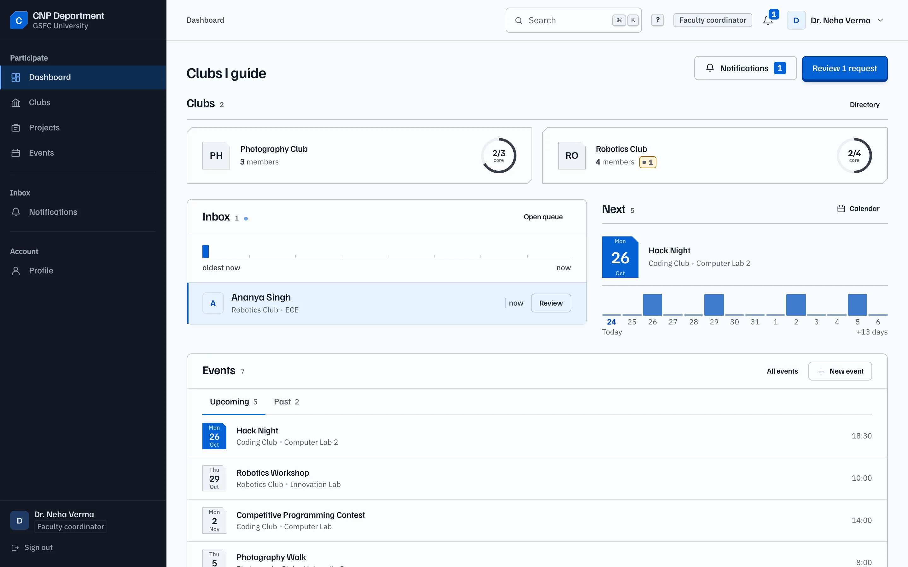<br/><sub><b>Coordinator</b> — the clubs they guide, and the queue as an inbox</sub></td>
</tr>
<tr>
<td><br/><sub><b>Club admin</b> — a coverage map: the empty coordinator slot is the loudest thing</sub></td>
<td>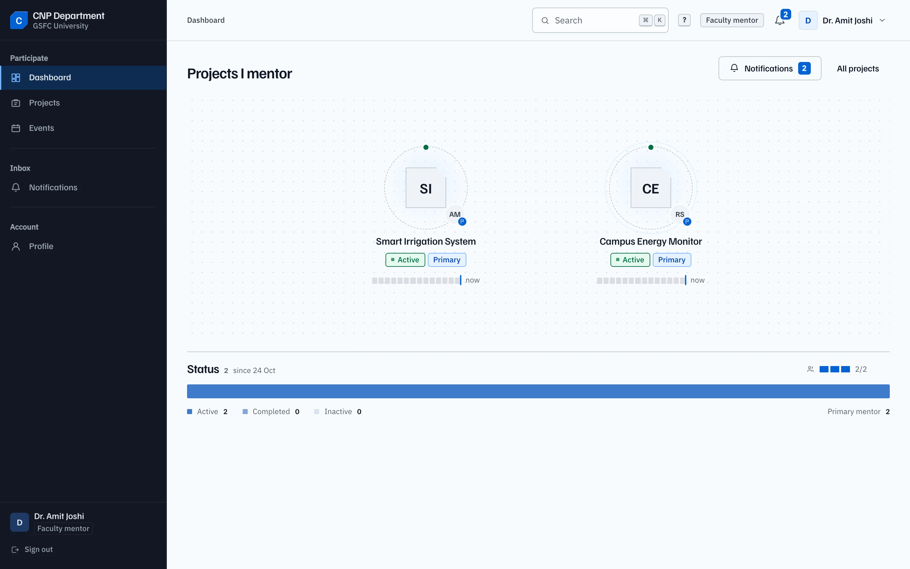<br/><sub><b>Mentor</b> — the constellation: calm, read-mostly, teams as nodes</sub></td>
</tr>
<tr>
<td colspan="2"><br/><sub><b>Project admin</b> — the console: portfolio blocks, queue depth, inventory as capacity cells</sub></td>
</tr>
</table>

> **Team leader** is not a global role. It is a per-project assignment stored on
> `Project.teamLeaderId`, shown as a mark on the project and in the roster — and enforced as a
> permission, not a label.

---

## A tour of the product

### The command palette

Everything is reachable from the keyboard. <kbd>⌘</kbd><kbd>K</kbd> searches the navigation, the
actions you are allowed to take, and real clubs, projects and events from the API.

<p align="center">
  
</p>

### Clubs

A club is an identity, not a row of text: a crest, a member stack, a core-team composition bar. The
detail page is the record — members, coordinator, next event, and the administration toolbar for the
people who run it. Joining asks for a seat; leaving is the same door in reverse, confirmed in place.
Core-team seats are released by an administrator, so the page does not offer that action.

<table>
<tr>
<td width="50%">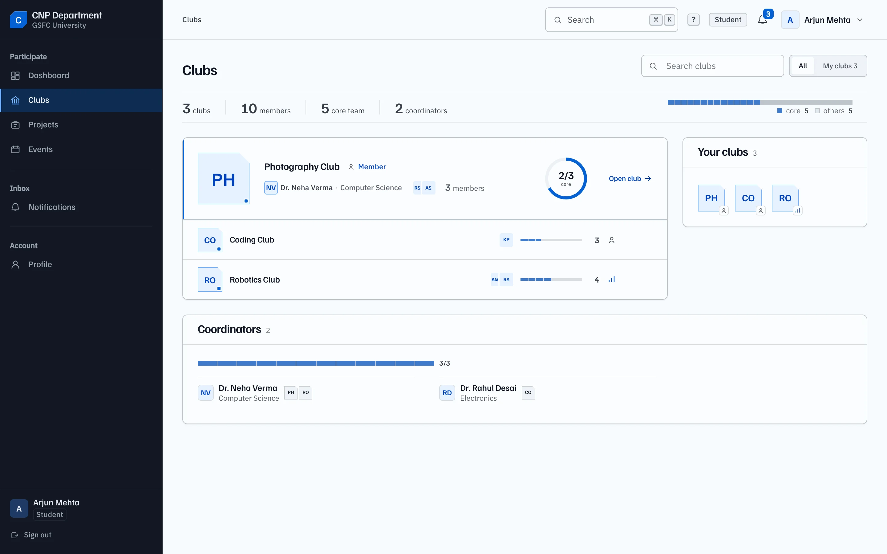<br/><sub><b>Directory</b> — a lead club, then ruled entries with crests</sub></td>
<td width="50%">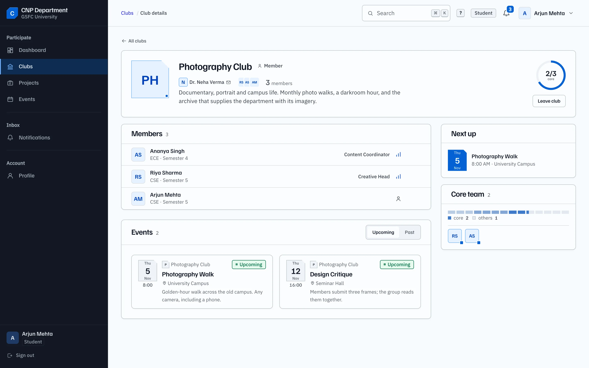<br/><sub><b>Club record</b> — members, composition, next up</sub></td>
</tr>
</table>

<p align="center">
  
</p>

### Projects

A portfolio sorted by what the project is doing, not by when it was created. The record carries the
team, the mentors, the materials, an updates timeline and the requests in flight.

<table>
<tr>
<td width="50%">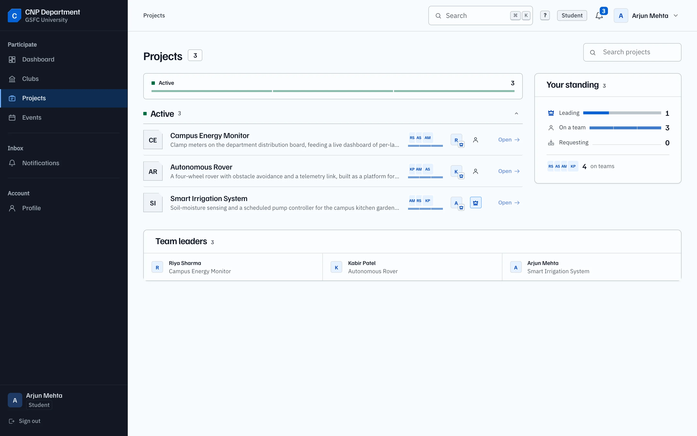<br/><sub><b>Portfolio</b> — status groups, team, leader, your standing</sub></td>
<td width="50%">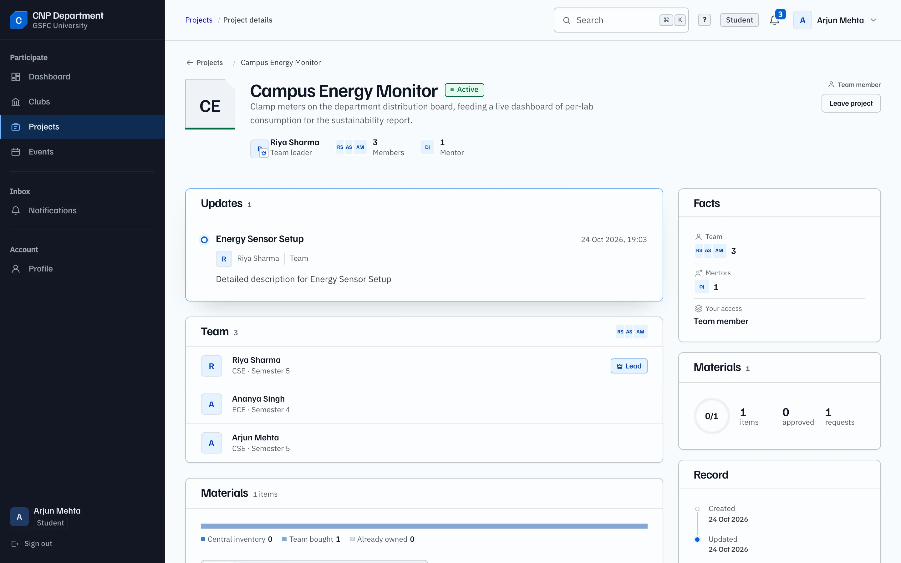<br/><sub><b>Project record</b> — updates, team, mentors, facts</sub></td>
</tr>
</table>

### Events

The calendar is the page: a month you can read at a glance, a selected day you can open, and an
agenda for the term. Creation is a modal over the calendar.

<p align="center">
  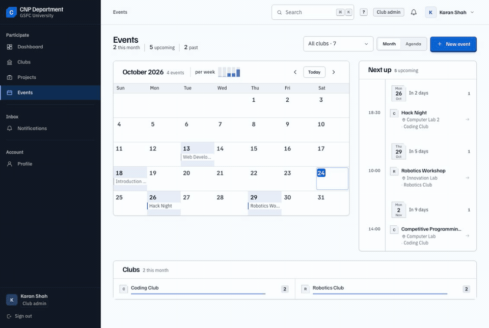
</p>

<p align="center">
  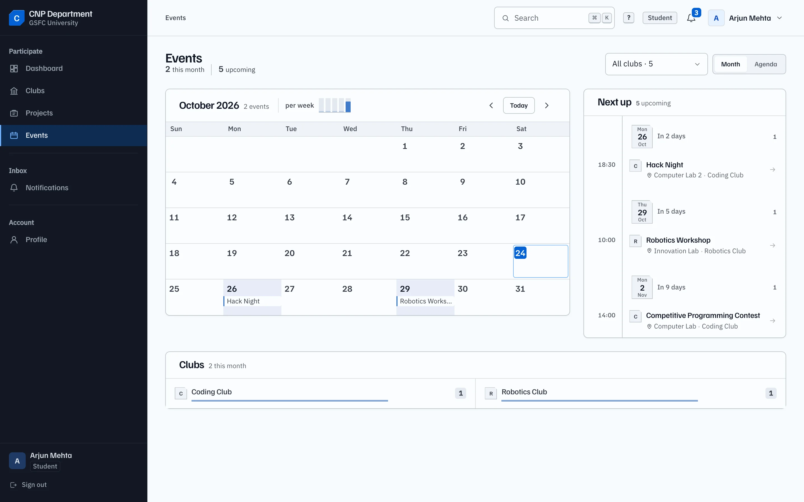
</p>

### The inbox

Notifications are a mail client, not a card wall: day groups on the left, the full record with its
facts and quote on the right, unread carried by a mark and a weight rather than colour alone. Read
state is two-way — a row can go back to unread, because an inbox you can only empty is not a filing
system.

<p align="center">
  
</p>

<p align="center">
  
</p>

### Operations

Two screens for the people who keep the labs running: the store room as a stock surface with
capacity, and the request queue as a pipeline with a guarded approve/reject.

<table>
<tr>
<td width="50%"><br/><sub><b>Inventory</b> — stock, allocations, low-stock signal</sub></td>
<td width="50%">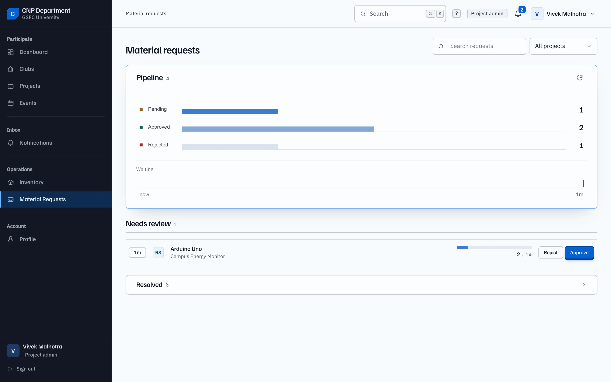<br/><sub><b>Requests</b> — what needs a decision now, resolved below</sub></td>
</tr>
</table>

### Administration

Destructive actions are styled confirmations that repeat the guard conditions of the API — no
`window.confirm`, no lost capability.

<p align="center">
  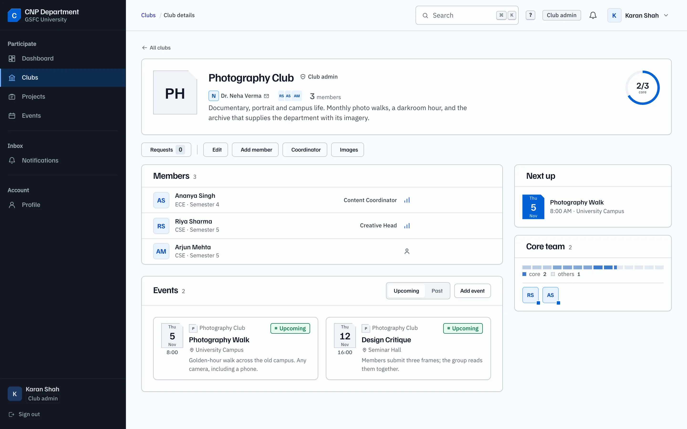
  <br/><sub><b>Club administration</b> — requests, members, coordinator, imagery, one toolbar</sub>
</p>

<p align="center">
  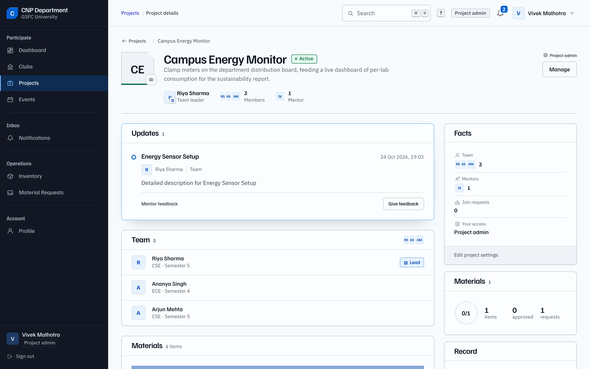
  <br/><sub><b>Project administration</b> — settings, team, materials and mentors in one composition</sub>
</p>

### Profile and the public door

<table>
<tr>
<td width="50%">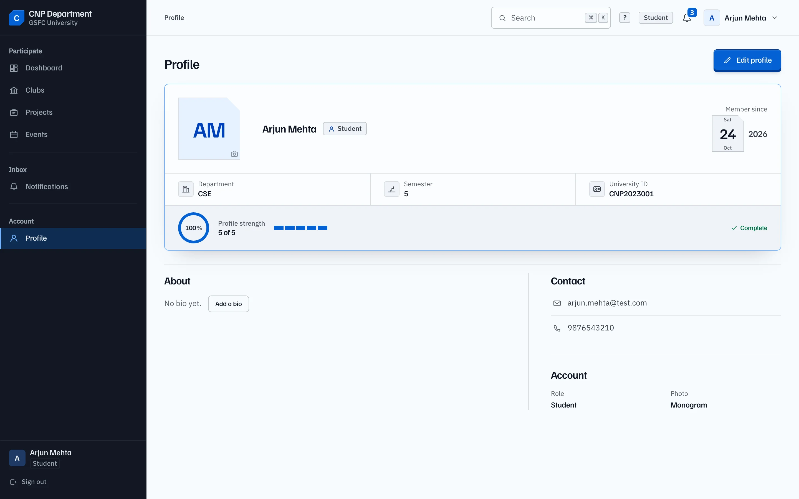<br/><sub><b>Profile</b> — an identity plate with a completeness ring</sub></td>
<td width="50%">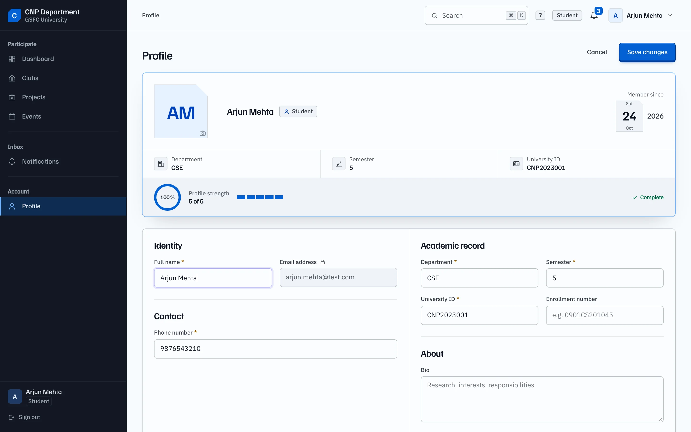<br/><sub><b>Edit</b> — one sheet, two postures</sub></td>
</tr>
<tr>
<td><br/><sub><b>Sign in</b> — the story panel beside the form</sub></td>
<td>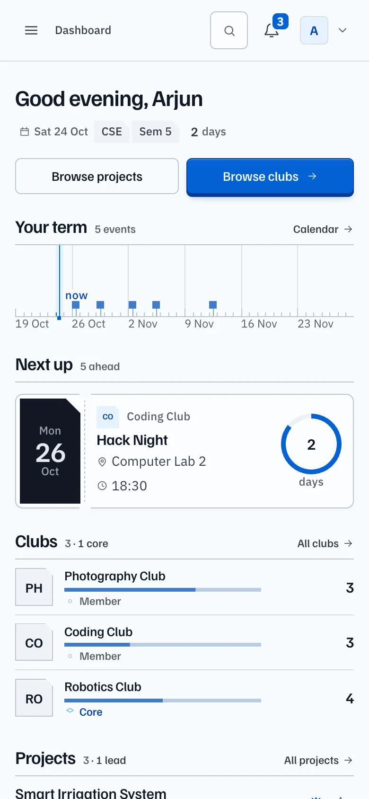<br/><sub><b>Mobile</b> — the rail becomes a drawer, the page one column</sub></td>
</tr>
</table>

---

## Design system · Cobalt

One visual language across the public page and the signed-in app. It is documented as a contract in
[`docs/redesign-brief.md`](docs/redesign-brief.md), so a new screen inherits it instead of
reinventing it.

| | |
|---|---|
| **Paper** | cool near-white `oklch(98.6% 0.005 250)`, white sheets on top |
| **Ink** | blue-black `oklch(21% 0.028 262)`, secondary grey-blue |
| **Signal** | one electric cobalt `oklch(52% 0.19 258)` — action, active, selection. Nothing else is blue |
| **Status** | positive / warning / negative, always paired with a word or a mark |
| **Type** | Familjen Grotesk for titles, names and numbers; IBM Plex Sans for everything else |
| **Form** | hairlines over shadows, cut corners on signature objects, tabular numerals |
| **Density** | a five-step glyph ramp for heat and rank; accent is a signal, never a series colour |
| **Motion** | 120–460 ms transitions that confirm a pointer or a state change; one entrance choreography per page |

**Everything is a token.** `frontend/src/tokens.css` holds every colour, space, radius, shadow and
duration; no component writes a literal. Four layers sit on top:

| Layer | Role |
|---|---|
| `frontend/src/ui.css` | the signed-in primitive layer — keys, panels, ruled rows, tables, tags, fields, tabs, stats, menus, modals, empty and skeleton states |
| `frontend/src/components/ui/vis.css` | **the instruments** — rings, sparklines, ranked bars, density grids, avatar stacks, date tiles, segmented meters, glyphs |
| `frontend/src/components/ui/chrome.css` | the command palette, tooltips and the shortcuts sheet |
| `frontend/src/landing.css` + `base.css` | the public page |

Pages compose these and add layout only, which is why eight screens built in parallel still read as
one product.

**Information as form.** The house rule is that a sentence describing data is a failure to draw it.
"2 events this week, next in 7 days" becomes a week strip with two filled cells and a marked next.
"42 members, 8 in the core team" becomes an avatar stack and a segmented bar. Anything that cannot
be drawn moves into a tooltip or a hover inspector — never into a paragraph.

### Light and dark

The whole product has a second reading: the same roles, inverted. The paper becomes the ink, the
cobalt keeps its hue and gains lightness so it still signals, and the graphite rail stays the
darkest surface on the screen so the frame never dissolves into the page. Every value lives in one
`[data-theme="dark"]` block in `frontend/src/tokens.css` — no component knows which theme it is in.

Two rules make it safe to maintain:

- **A theme is a choice, not a device.** Light is the default for everyone; the switch in the
  sidebar footer stores the answer in `localStorage` and a tiny script in `index.html` paints it
  before the first frame, so a dark session never flashes white.
- **No literal colours, anywhere.** Because every surface is a role, dark mode is one block of
  overrides rather than a second stylesheet — and every text pair is measured at 4.5:1 in both.

<table>
<tr>
<td width="50%"><br/><sub><b>Light</b> — cool paper, blue-black ink</sub></td>
<td width="50%">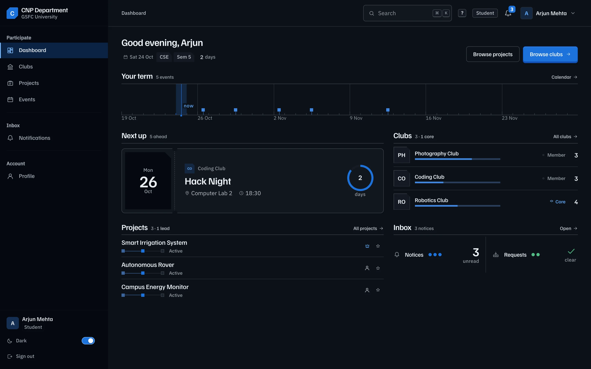<br/><sub><b>Dark</b> — the same instrument after dark</sub></td>
</tr>
</table>

**Accessibility is the floor, not a pass.** Visible `:focus-visible` on every control, real
`<button>`/`<a>` semantics, `aria-pressed` / `aria-expanded` / `aria-current`, `role="img"` with a
name on every data visual, Escape to close every overlay with focus returned to the trigger,
labelled inputs, 4.5:1 body contrast measured on every screen, and a `prefers-reduced-motion` guard
in every stylesheet. The boot screen is a register that opens — a cobalt cover swinging back on its
spine to reveal the page underneath; under reduced motion it simply starts open, and the page it
reveals fades in rather than cutting.

---

## Architecture

| Layer | Choice |
|---|---|
| Frontend | React 19, TypeScript 6, Vite 8, React Router 7 — no UI kit, no CSS framework, no chart library |
| Styling | CSS custom properties + one stylesheet per surface; data visuals are hand-authored SVG and CSS |
| Backend | Express 5, Mongoose 8, JWT bearer auth, Cloudinary for uploads, `node-cron` for event reminders |
| Data | MongoDB — 15 collections |
| Uploads | `multer` in memory → Cloudinary; assets are deleted when their record is |
| Tests | Vitest + Testing Library (frontend), Vitest + Supertest + in-memory Mongo (backend) |

```
frontend/src
├── pages/             one folder per area, each with its own stylesheet
│   ├── Landing/       the public page
│   ├── Dashboard/     role router + five role dashboards
│   ├── Clubs/         directory + club record
│   ├── Projects/      portfolio + project record
│   ├── Events/        calendar, agenda, detail, form
│   ├── Notifications/
│   ├── Inventory/     + MaterialRequests/
│   ├── Profile/
│   └── Auth/          sign in + student sign-up
├── components/
│   ├── layout/        the shell: rail, header, drawer, route rail
│   ├── ui/            instruments (vis), chrome (palette, tooltips, shortcuts)
│   ├── landing/       nav, hero, sections, footer
│   └── clubs/ · projects/ · events/ · dashboard/
├── ui.css             the signed-in primitive layer
├── tokens.css         the only source of colour, space, type, motion
├── services/api.ts    the typed API client
└── eventDate.ts       local-day arithmetic shared by every calendar surface

backend
├── server.js          the app + route mount map
├── src/routes/        auth, clubs, projects, join requests, mentors, updates,
│                      events, materials, inventory, allocations, notifications,
│                      dashboard, search
├── src/models/        15 Mongoose schemas
├── src/services/      notifications, event reminders, Cloudinary
├── src/lib/http.js    query parsing, pagination, error mapping
├── scripts/           backfill + smoke
└── tests/             278 tests over 15 files
```

### The data model

| Collection | Holds | Key relationships |
|---|---|---|
| `User` | identity, role, department, semester, university ID, profile completeness | referenced by every record as actor or owner |
| `Club` | name, description, logo, coordinator, `foundedAt` | `facultyCoordinatorId → User` |
| `ClubMembership` | a student's seat in a club: `member` or `core_team`, position, `joinedAt` | unique on `(studentId, clubId)` |
| `Project` | name, description, status, domain, `teamLeaderId` | `teamLeaderId → User` |
| `ProjectMembership` | a student's place on a team | unique on `(studentId, projectId)` |
| `ProjectMentor` | a faculty mentor assigned to a project | unique on `(mentorId, projectId)` |
| `ProjectUpdate` / `ProjectFeedback` | the timeline and the mentor's written feedback | `projectId`, `authorId` |
| `ProjectMaterial` | a material attached to a project | `projectId → GuitarInventory` |
| `Event` | title, date, location, club, status | `clubId → Club` |
| `JoinRequest` | one request for a club **or** a project, with `status` | `studentId`, `clubId` / `projectId` |
| `Notification` | kind, title, message, `isRead`, deep link | `userId`, 60-day TTL index |
| `GuitarInventory` | an item, quantities, `minimumStock` (the reorder floor) | — |
| `InventoryAllocation` | stock handed to a project, with return state | `itemId`, `projectId` |
| `MaterialRequest` | a project's request for quantity of an item, with decision state | `itemId`, `projectId` |

Membership and join state are deliberately separate collections: a seat can be revoked, a request
can be rejected, and the history of both stays.

### The API

Base path `/api`. Every response is a JSON envelope — `{ success, message?, data?, count? }` — and
every handler funnels errors through one mapper, so a malformed id is a `400` with a readable
message rather than a `500` with a Mongo stack trace.

| Area | Endpoints |
|---|---|
| Auth | `POST /auth/register` · `POST /auth/login` · `GET /auth/me` · `POST /auth/logout` |
| Clubs | `GET /clubs` (`q`, `scope=joined\|all`, `coordinatorId`, pagination) · `GET /clubs/:id` · `POST` · `PUT` · `DELETE` · `GET /clubs/summary` · `GET /clubs/:id/members` (`q`, `sort`) · `POST /clubs/:id/join` · `DELETE /clubs/:id/join` |
| Projects | `GET /projects` (`q`, `status`, `mine=1`, pagination) · `GET /projects/:id` · `GET /projects/summary` · `…/members` · `…/mentors` · `…/materials` · `…/updates` · `POST /projects/:id/join` · `DELETE /projects/:id/join` |
| Requests | `GET /join-requests/student` · `GET /join-requests/club/:id` · `GET /join-requests/project/:id` · `PATCH /join-requests/:id/approve` · `…/reject` |
| Events | `GET /events` (`month`, `clubId`) · `GET /events/upcoming?from=` · `GET /events/summary` · CRUD |
| Inbox | `GET /notifications` (`status`, `type`, cursor) · `GET /notifications/unread-count` · `PATCH /:id/read` · `PATCH /:id/unread` · `PATCH /read-all` |
| Store room | `GET /inventory` · `GET /inventory/summary` · `PATCH /inventory/:id/quantity` · allocations · material requests (`approve`, `reject`, `bulk-approve`, `bulk-reject`) |
| Cross-cutting | `GET /dashboard/summary` · `GET /search?q=` · `GET /users/:id/projects` · `GET /mentors/:id/projects` |

Every list endpoint accepts a cursor or `page`/`limit` and applies filters in MongoDB; the browser
never fetches a whole collection to narrow it. `memberCount`, `myRelation`, `myMembership`,
`pendingRequestCount` and the per-area summaries are computed server-side, so a page can render its
headline numbers from one request.

The full endpoint-by-endpoint record, including response shapes, is in
[`docs/backend-changes.md`](docs/backend-changes.md).

### Authentication and authorisation

- JWT in the `Authorization: Bearer` header, `JWT_EXPIRES_IN` (default `7d`), identity resolved into
  `req.user` by `requireAuth`.
- `requireRole` / `requireAnyRole` guard the route itself; the same checks run again in the handler
  where the permission is finer than the route (for example *this* club's coordinator, or the
  project's own team leader).
- Passwords are bcrypt hashes; the hash never leaves the model layer.
- **Self-registration creates students only.** A role is an authorisation claim, not a preference —
  staff accounts are provisioned, or the deployment widens `REGISTRATION_ROLES` deliberately.
- The frontend stores the token in `localStorage` under `cnp_auth_token`. A `401` clears it and
  signals the shell, so an expired session becomes a clean sign-out instead of a dead screen.

### Data flow

Pages call `api<T>(method, endpoint, body?)`. The client attaches the token, throws a typed
`ApiError` on a non-OK response, and omits the `Content-Type` header on bodyless requests so a
`GET` is not preflighted. Every page owns its loading, empty, error and success states.

There is no cache layer by design. Summaries are aggregated server-side; lists are filtered and
paginated server-side where the volume warrants it; a page that mutates a record refetches the
records it depends on.

---

## Install and run

**Prerequisites**

| | |
|---|---|
| Node | 20 or newer |
| MongoDB | 6+ locally, or an Atlas connection string |
| Cloudinary | a free account — required only for image upload (club logos, project and profile images) |

### 1 · Backend

```bash
cd backend
npm install
cp .env.example .env
#   MONGODB_URI=mongodb://127.0.0.1:27017/cnp_department
#   JWT_SECRET=<output of the command below>
#   CLOUDINARY_CLOUD_NAME / API_KEY / API_SECRET
node -e "console.log(require('crypto').randomBytes(64).toString('hex'))"
npm run seed          # demo clubs, projects, events, requests, inventory
npm run dev           # http://localhost:5000
```

`PORT` defaults to `5000`. Mongo must be reachable at the `MONGODB_URI` before `npm run seed`.

### 2 · Frontend

```bash
cd frontend
npm install
cp .env.example .env   # VITE_API_URL=http://localhost:5000/api   (no trailing slash)
npm run dev            # http://localhost:5173
```

If you change the backend port, change `VITE_API_URL` to match. Both sides read their environment at
start-up; restart the dev server after editing `.env`.

### Environment variables

| File | Variable | Required | Purpose |
|---|---|---|---|
| `backend/.env` | `MONGODB_URI` | yes | Mongo connection string |
| | `JWT_SECRET` | yes | signing key, 32+ random chars |
| | `JWT_EXPIRES_IN` | no | token lifetime, default `7d` |
| | `PORT` | no | default `5000` |
| | `CLOUDINARY_CLOUD_NAME` / `_API_KEY` / `_API_SECRET` | for uploads | image storage |
| | `REGISTRATION_ROLES` | no | comma-separated roles the public form may create; default `student` |
| `frontend/.env` | `VITE_API_URL` | yes | API base, e.g. `http://localhost:5000/api` |

`.env` is git-ignored on both sides. `.env.example` is safe to commit and lists every key.

### Demo accounts

Created by `npm run seed`. The password for all of them is `Test@12345`.

| Role | Email | Opens with |
|---|---|---|
| Student | `arjun.mehta@test.com` | their term, memberships, inbox |
| Faculty coordinator | `neha.verma@test.com` | two clubs and a request queue |
| Faculty mentor | `amit.joshi@test.com` | mentored projects and feedback |
| Club admin | `karan.shah@test.com` | the club programme and its gaps |
| Project admin | `vivek.malhotra@test.com` | the console: portfolio, materials, inventory |

Signing in as more than one role in different browser profiles is the fastest way to see the five
experiences side by side.

### Scripts

| Where | Command | What it does |
|---|---|---|
| `frontend/` | `npm run dev` | Vite dev server |
| `frontend/` | `npm run build` | typecheck + production build |
| `frontend/` | `npm run preview` | serve the production build |
| `frontend/` | `npm test` | the frontend suite |
| `frontend/` | `npm run test:coverage` | suite + V8 coverage |
| `backend/` | `npm run dev` | Node watch mode |
| `backend/` | `npm start` | production server |
| `backend/` | `npm run seed` | reset the demo data |
| `backend/` | `npm test` | the API suite (in-memory Mongo, no server needed) |
| `backend/` | `npm run test:coverage` | suite + coverage |
| `backend/` | `npm run backfill` | idempotent migration for schema fields added later |

---

## Using it

**Students.** Sign in and the dashboard answers what the term looks like: the next event as a
ticket, the clubs you belong to as crests, your projects with their status, and the inbox as a
signal strip. From there you browse the directory, request a seat in a club or a project, read the
record, and follow the events you are eligible for.

**Faculty coordinators.** The dashboard is a queue: the clubs you guide, the requests waiting for a
decision, and the events in flight. Approving a request creates the membership in the same
transaction that closes the request.

**Faculty mentors.** A read-mostly view of the teams you mentor, with the feedback you owe them and
the updates they have posted.

**Club admins.** Coverage across the club programme — which clubs have a coordinator, which are
waiting on requests, what is happening this month — plus the club record's administration toolbar
for members, roles, imagery and events.

**Project admins.** The portfolio console: project blocks by status, the material queue, and the
store room as a stock surface. Approving a material request deducts stock and creates the
allocation; if either step fails the deduction is compensated, so the counts cannot drift.

**Everyone.** <kbd>⌘</kbd><kbd>K</kbd> opens the command palette; <kbd>?</kbd> shows every shortcut.

### Keyboard

| Keys | Action |
|---|---|
| <kbd>⌘</kbd><kbd>K</kbd> / <kbd>Ctrl</kbd><kbd>K</kbd> | command palette |
| <kbd>?</kbd> | shortcut sheet |
| <kbd>/</kbd> | focus the page search |
| <kbd>g</kbd> then <kbd>d</kbd> <kbd>c</kbd> <kbd>p</kbd> <kbd>e</kbd> <kbd>n</kbd> <kbd>s</kbd> | dashboard, clubs, projects, events, notifications, settings/profile |
| <kbd>↑</kbd> <kbd>↓</kbd> · <kbd>↵</kbd> · <kbd>esc</kbd> | move, open, close inside the palette |
| <kbd>esc</kbd> | close any overlay; focus returns to the trigger |

---

## Testing

**378 tests, green.**

| Suite | Tests | Coverage | What it locks down |
|---|---|---|---|
| `frontend/` | **100** | 96.5 % statements · 99.3 % lines | the API client (headers, `ApiError`, 401 recovery), profile completeness, auth context, the theme store, route guards, event partitioning, tooltip behaviour, the sign-in form |
| `backend/` | **278** | 73.4 % statements · 83.1 % functions | the role matrix per route, join-request and material-request workflows, stock arithmetic, notification ownership, response envelopes, validation and error mapping |

```bash
cd backend  && npm test     # 278 passed · ~23s
cd frontend && npm test     # 100 passed ·  ~6s
```

The backend suite runs against a **real in-memory MongoDB**, not a stub, so unique indexes,
`$lookup` aggregations and atomic `findOneAndUpdate` claims behave exactly as in production. The
frontend suite stubs `fetch` and never touches the network.

Strategy and gaps: [`docs/testing.md`](docs/testing.md) · API suite structure:
[`backend/tests/README.md`](backend/tests/README.md).

---

## Routes

| Route | Access | Screen |
|---|---|---|
| `/` | public | landing page |
| `/login`, `/register` | public | authentication, student sign-up |
| `/dashboard` | signed in | role-specific dashboard |
| `/clubs`, `/clubs/:id` | signed in | directory, club record |
| `/projects`, `/projects/:id` | signed in | portfolio, project record |
| `/events` | signed in | calendar, agenda, detail |
| `/notifications` | signed in | inbox |
| `/profile` | signed in | profile record and form |
| `/inventory` | project admin | stock and allocations |
| `/material-requests` | project admin | request pipeline |

Incomplete student profiles are redirected to `/profile` until the university ID and semester are
set. `ProtectedRoute` handles authentication, `RoleProtectedRoute` handles the two operations
routes, and the API re-checks every role on every request.

---

## Documentation

| Document | What is in it |
|---|---|
| [`docs/backend-changes.md`](docs/backend-changes.md) | every endpoint, schema field and index, with the reasoning and the trade-offs |
| [`docs/backend-mocks.md`](docs/backend-mocks.md) | what the UI still derives client-side, and the endpoint that would replace it |
| [`docs/testing.md`](docs/testing.md) | test strategy, stack choices, coverage, gaps |
| [`docs/redesign-brief.md`](docs/redesign-brief.md) | the design contract: tokens, primitives, page anatomy, accessibility floor |
| [`docs/visual-pass.md`](docs/visual-pass.md) | the instrument rule: text budget, box budget, motion, visual grammar |
| [`docs/mocks/`](docs/mocks) | per-area detail behind the wiring backlog |
| [`AGENTS.md`](AGENTS.md) | repository conventions for contributors and coding agents |

---

## License

ISC — see [`backend/package.json`](backend/package.json).

Built for the Centre for Networked Programmes, GSFC University, Vadodara.
